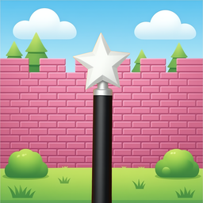

<p align="center">
  
</p>

<h1 align="center">MagicWall</h1>

<p align="center">
  <b>Video wallpaper locali per macOS.</b><br>
  <em>Native, lightweight local video wallpapers for macOS.</em>
</p>

<p align="center">
  <a href="https://github.com/davidullo/magicwall/releases/latest"></a>
  
  
  
</p>

---

## ⬇️ Download

L'ultima versione è **firmata Developer ID e notarizzata da Apple**: si apre
senza avvisi di Gatekeeper.

1. Scarica `MagicWall-<versione>.dmg` dalla
   [pagina delle release](https://github.com/davidullo/magicwall/releases/latest).
2. Aprilo e trascina **MagicWall** in *Applicazioni*.
3. Al primo avvio l'app crea la libreria locale e importa i tuoi video.

Serve **macOS 15 o successivo**. Le build sono universali (Apple Silicon e Intel).

## ✨ Funzionalità

- **Libreria locale** — import drag & drop di file e cartelle, poster generati
  automaticamente, categorie, preferiti, ricerca e rinomina.
- **Preview fullscreen** — sfoglia il video prima di applicarlo, con azioni
  rapide (play, rinomina, preferiti, categorie).
- **Multi-monitor** — un video diverso per ogni schermo; gli assegnamenti
  sopravvivono al riavvio e vengono ripristinati da soli.
- **Politica energia** — pausa automatica su batteria, risparmio energetico,
  pressione termica, schermo bloccato o desktop occluso, con recovery dopo
  sleep/wake.
- **Menu bar** — pausa, shuffle, preferiti e stop senza aprire la finestra.
- **Temi** — editor dei token grafici (colori, raggi, gradienti) e modalità
  chiara/scura.
- **Italiano e inglese** — l'interfaccia segue la lingua di sistema.
- **Tutto in locale** — nessun account, nessuna telemetria, nessun traffico di
  rete.

## 🚀 Come si usa

1. Apri MagicWall → "+" (o trascina file/cartelle MP4/MOV nella finestra).
2. Nella card premi play → preview; "Riproduci come wallpaper" per applicarlo a
   tutti gli schermi (o tasto destro → "Set on Screen" per un singolo monitor).
3. L'app resta nel menu bar: pausa, shuffle, preferiti, stop. Da Impostazioni →
   Riproduzione puoi regolare le pause automatiche (batteria, risparmio
   energetico, pressione termica, schermo bloccato, desktop nascosto).
4. Tasto destro su una card (o pulsante matita nella preview) → **Rinomina** per
   dare un titolo personalizzato ai video importati.
5. Gli assegnamenti per schermo sopravvivono al riavvio e vengono ripristinati
   automaticamente.

## 📊 Stato del progetto

- **M1** (fondamenta): ✅ progetto, schema DB, import video, poster, libreria
- **M2** (engine): ✅ finestre desktop-level per schermo, loop gapless, persistenza
  per-monitor, restore all'avvio, policy energia, recovery al wake
- **M3** (UI libreria): ✅ top bar + hero + caroselli + Explore + preview fullscreen
- **M4** (hardening/release): ✅ policy energia, test E2E, tema, i18n, firma
  Developer ID + notarizzazione, script di release; ⏳ transcode HEVC (da fare)
- **M5** (community): futuro

## 🖥️ Requisiti

**Per usare l'app**

- macOS 15 o successivo (sviluppato e testato su macOS 27)

**Per compilare**

- Xcode 27.x con SDK macOS
- [XcodeGen](https://github.com/yonaskolb/XcodeGen) (`brew install xcodegen`)

## 🛠️ Build & run

```bash
export DEVELOPER_DIR=/Applications/Xcode.app/Contents/Developer

# genera il progetto Xcode da project.yml (la source of truth è project.yml,
# non editare MagicWall.xcodeproj: è generato e in .gitignore)
xcodegen generate

xcodebuild -project MagicWall.xcodeproj -scheme MagicWall \
  -configuration Debug -derivedDataPath /tmp/mw-dd build

open /tmp/mw-dd/Build/Products/Debug/MagicWall.app
```

Test del core:

```bash
cd Packages/MagicWallCore && swift test
```

## 📦 Release

La versione si imposta in `project.yml` (`MARKETING_VERSION` e
`CURRENT_PROJECT_VERSION`). Per creare gli artefatti distribuibili:

```bash
./Scripts/release.sh            # build universale (arm64 + x86_64)
./Scripts/release.sh --native   # solo l'architettura di questa Mac, più veloce
```

Gli artefatti finiscono in `dist/`:

- `MagicWall-<versione>.dmg` (app + collegamento ad Applicazioni)
- `MagicWall-<versione>.zip`
- `MagicWall-<versione>.dSYM.zip` (simboli per i crash report)
- `SHA256SUMS.txt`

La build locale è firmata ad-hoc: funziona su questa Mac, ma su altre macchine
Gatekeeper la blocca perché non è notarizzata. Per una release senza attriti
serve un account Apple Developer:

```bash
SIGN_IDENTITY="Developer ID Application: Nome (TEAMID)" \
NOTARY_PROFILE=magicwall \
./Scripts/release.sh --notarize
```

Il profilo `magicwall` si crea una volta con
`xcrun notarytool store-credentials magicwall --apple-id ... --team-id ...`.
Per pubblicare la release su GitHub (dopo aver configurato il remote e
`gh auth login`):

```bash
./Scripts/release.sh --publish
```

Lo script non fa push del repository: crea solo la release `v<versione>` con gli
artefatti allegati.

## 🏗️ Architettura

```
MagicWall/                    app target (SwiftUI, non sandboxed)
├── App/                      entrypoint, wiring, view model, gestione finestra
├── UI/                       viste della libreria (stile Netflix)
├── Engine/                   engine wallpaper (NSWindow desktop-level, AVPlayerLooper,
│                             PlaybackPolicy: batteria/lock/termico/occlusione/wake)
├── MenuBar/                  menu bar extra
├── Settings/                 finestra impostazioni
└── Services/                 login item (SMAppService)

Packages/MagicWallCore/       logica condivisa e testabile
├── Models/                   Video, VideoCategory, Playlist, ScreenAssignment
├── Database/                 GRDB (schema + migrazioni + repository)
└── Media/                    probe AVFoundation, SHA-256, poster, import
```

### Come funziona l'engine

Una `NSWindow` borderless per schermo al livello `kCGDesktopWindowLevel`
(verificato: le icone del Finder stanno a `kCGDesktopWindowLevel + 20`), con
`AVQueuePlayer` + `AVPlayerLooper` (loop senza salti, decodifica hardware).
`ignoresMouseEvents`, `canJoinAllSpaces`, nessuna attivazione app richiesta.
Gli assegnamenti per schermo sono persistiti nel DB (`screen_assignments`,
chiave `display:<CGDirectDisplayID>`) e ripristinati a ogni avvio.

### Ciclo di vita della finestra

Chiudere la finestra **non** chiude l'app: l'engine continua a girare e il
wallpaper non si interrompe. Cliccando di nuovo l'icona nel Dock (o "Apri
MagicWall" dal menu bar) la finestra viene ricreata — vedi
`MagicWall/App/MainWindow.swift`.

## 💾 Dati locali

```
~/Library/Application Support/MagicWall/
├── magicwall.sqlite
└── Library/
    ├── Videos/<uuid>.<ext>
    └── Posters/<uuid>.jpg
```

L'app è completamente locale: nessun account, telemetria o traffico di rete.

Per test e sviluppo puoi spostare l'intera directory dati con la variabile
d'ambiente `MAGICWALL_DATA_DIR` (usata anche da `mwctl` e dai test E2E).

## 🧪 Test

Core (unità):

```bash
cd Packages/MagicWallCore
DEVELOPER_DIR=/Applications/Xcode.app/Contents/Developer swift test
```

E2E UI (XCUITest, apre e pilota l'app reale):

```bash
./Scripts/e2e.sh                                       # tutta la suite E2E
./Scripts/e2e.sh -only-testing:MagicWallUITests/MagicWallUITests/testTabNavigationSwitchesContent
```

Copre: sidebar completa, navigazione tra tab, regressione "preview sopra la
sidebar", chiusura preview con X ed Esc, rinomina dei video, stato di libreria
vuota, apertura Impostazioni con tab Theme e riapertura della finestra dopo la
chiusura (regressione del ciclo di vita).

Note:
- al primo giro macOS può chiedere il permesso di **Accessibility**/Automation
  per Xcode/terminal: va concesso per far girare i click sintetici;
- su macOS i test usano `click()` (non `tap()`);
- `e2e.sh` genera un video di test, importa una libreria isolata in una
  directory temporanea e la passa ai test con `MAGICWALL_DATA_DIR`: la libreria
  reale non viene mai modificata;
- il test della libreria vuota crea invece una directory temporanea vuota;
- log completo in `/tmp/mw-e2e.log`.

## 🔧 Dev tools

- `DevTools/make-test-video.swift` — genera un video di test animato:
  `swift DevTools/make-test-video.swift DevFixtures/test-pattern.mp4`

## 📄 Licenza

Il codice di MagicWall è distribuito con licenza **MIT** (vedi
[`LICENSE`](LICENSE)). Le dipendenze di terze parti sono elencate in
[`THIRD_PARTY_NOTICES.md`](THIRD_PARTY_NOTICES.md).
