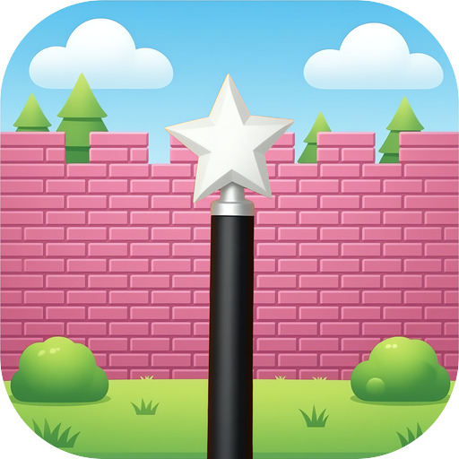

<p align="center">
  
</p>

<h1 align="center">MagicWall</h1>

<p align="center">
  <b>Local video wallpapers for macOS.</b><br>
  <em>Native, lightweight and completely offline.</em>
</p>

<p align="center">
  <a href="https://github.com/davidullo/magicwall/releases/latest"></a>
  
  
  
</p>

---

## ⬇️ Download

The latest release is **signed with a Developer ID and notarized by Apple**, so
it opens without Gatekeeper warnings.

1. Download `MagicWall-<version>.dmg` from the
   [releases page](https://github.com/davidullo/magicwall/releases/latest).
2. Open it and drag **MagicWall** into *Applications*.
3. On first launch the app creates its local library — import your videos and
   set them as wallpapers.

Requires **macOS 15 or later**. Builds are universal (Apple Silicon and Intel).

## ✨ Features

- **Local library** — drag & drop import of files and folders, automatically
  generated posters, categories, favorites, search and rename.
- **Fullscreen preview** — browse a video before applying it, with quick
  actions (play, rename, favorites, categories).
- **Multi-monitor** — a different video for each display; assignments survive
  restarts and are restored automatically.
- **Power policy** — automatic pausing on battery, Low Power Mode, thermal
  pressure, screen lock or occluded desktop, with recovery after sleep/wake.
- **Menu bar** — pause, shuffle, favorites and stop without opening the window.
- **Themes** — editable design tokens (colors, corner radii, gradients) plus
  light/dark appearance.
- **English and Italian** — the UI follows the system language.
- **Completely local** — no accounts, no telemetry, no network traffic.

## 🚀 Getting started

1. Open MagicWall → "+" (or drag MP4/MOV files and folders into the window).
2. Play a card to open the preview, then "Play as wallpaper" to apply it to
   every screen (or right-click → "Set on Screen" for a single monitor).
3. The app stays in the menu bar: pause, shuffle, favorites, stop. In
   Settings → Playback you can tune the automatic pauses (battery, Low Power
   Mode, thermal pressure, screen lock, hidden desktop).
4. Right-click a card (or use the pencil button in the preview) → **Rename** to
   give imported videos a custom title.
5. Per-screen assignments survive restarts and are restored automatically.

## 📊 Project status

- **M1** (foundation): ✅ project, database schema, video import, posters, library
- **M2** (engine): ✅ per-screen desktop-level windows, gapless looping,
  per-monitor persistence, restore on launch, power policy, wake recovery
- **M3** (library UI): ✅ top bar + hero + carousels + Explore + fullscreen preview
- **M4** (hardening/release): ✅ power policy, E2E tests, themes, i18n,
  Developer ID signing + Apple notarization, release script; ⏳ HEVC transcode (todo)
- **M5** (community): future

## 🖥️ Requirements

**To use the app**

- macOS 15 or later (developed and tested on macOS 27)

**To build**

- Xcode 27.x with the macOS SDK
- [XcodeGen](https://github.com/yonaskolb/XcodeGen) (`brew install xcodegen`)

## 🛠️ Build & run

```bash
export DEVELOPER_DIR=/Applications/Xcode.app/Contents/Developer

# generate the Xcode project from project.yml (project.yml is the source of
# truth; never edit MagicWall.xcodeproj, it is generated and gitignored)
xcodegen generate

xcodebuild -project MagicWall.xcodeproj -scheme MagicWall \
  -configuration Debug -derivedDataPath /tmp/mw-dd build

open /tmp/mw-dd/Build/Products/Debug/MagicWall.app
```

Run the core tests:

```bash
cd Packages/MagicWallCore && swift test
```

## 📦 Release

The version lives in `project.yml` (`MARKETING_VERSION` and
`CURRENT_PROJECT_VERSION`). To produce the distributable artifacts:

```bash
./Scripts/release.sh            # universal build (arm64 + x86_64)
./Scripts/release.sh --native   # this Mac's architecture only, faster
```

Artifacts are written to `dist/`:

- `MagicWall-<version>.dmg` (app + Applications symlink)
- `MagicWall-<version>.zip`
- `MagicWall-<version>.dSYM.zip` (symbols for crash reports)
- `SHA256SUMS.txt`

Local builds are ad-hoc signed: they run on this Mac, but other Macs will be
blocked by Gatekeeper because they are not notarized. For a frictionless
release you need an Apple Developer account:

```bash
SIGN_IDENTITY="Developer ID Application: Name (TEAMID)" \
NOTARY_PROFILE=magicwall \
./Scripts/release.sh --notarize
```

Create the `magicwall` profile once with
`xcrun notarytool store-credentials magicwall --apple-id ... --team-id ...`.
To publish the GitHub release (after configuring the remote and
`gh auth login`):

```bash
./Scripts/release.sh --publish
```

The script never pushes the repository: it only creates the `v<version>`
release with the artifacts attached.

## 🏗️ Architecture

```
MagicWall/                    app target (SwiftUI, not sandboxed)
├── App/                      entrypoint, wiring, view model, window lifecycle
├── UI/                       library views (Netflix-style)
├── Engine/                   wallpaper engine (desktop-level NSWindow, AVPlayerLooper,
│                             PlaybackPolicy: battery/lock/thermal/occlusion/wake)
├── MenuBar/                  menu bar extra
├── Settings/                 settings window
└── Services/                 login item (SMAppService)

Packages/MagicWallCore/       shared, testable logic
├── Models/                   Video, VideoCategory, Playlist, ScreenAssignment
├── Database/                 GRDB (schema + migrations + repository)
└── Media/                    AVFoundation probing, SHA-256, posters, import
```

### How the engine works

One borderless `NSWindow` per screen at `kCGDesktopWindowLevel` (verified:
Finder icons live at `kCGDesktopWindowLevel + 20`), driven by `AVQueuePlayer` +
`AVPlayerLooper` (gapless looping, hardware decoding). `ignoresMouseEvents`,
`canJoinAllSpaces`, no app activation required. Per-screen assignments are
persisted in the database (`screen_assignments`, key `display:<CGDirectDisplayID>`)
and restored on every launch.

### Window lifecycle

Closing the window does **not** quit the app: the engine keeps running so the
wallpaper never stops. Clicking the Dock icon again (or "Open MagicWall" from
the menu bar) recreates the window — see `MagicWall/App/MainWindow.swift`.

## 💾 Local data

```
~/Library/Application Support/MagicWall/
├── magicwall.sqlite
└── Library/
    ├── Videos/<uuid>.<ext>
    └── Posters/<uuid>.jpg
```

The app is completely offline: no accounts, no telemetry, no network traffic.

For development and tests you can move the whole data directory with the
`MAGICWALL_DATA_DIR` environment variable (also honored by `mwctl` and the E2E
tests).

## 🧪 Tests

Core (unit tests):

```bash
cd Packages/MagicWallCore
DEVELOPER_DIR=/Applications/Xcode.app/Contents/Developer swift test
```

E2E UI tests (XCUITest, drives the real app):

```bash
./Scripts/e2e.sh                                       # full E2E suite
./Scripts/e2e.sh -only-testing:MagicWallUITests/MagicWallUITests/testTabNavigationSwitchesContent
```

Covers: complete sidebar, tab navigation, the "preview above the sidebar"
regression, preview dismissal via X and Esc, video rename, empty-library state,
Settings with the Theme tab, and window reopen after close (lifecycle
regression).

Notes:
- on the first run macOS may ask for **Accessibility**/**Automation** permission
  for Xcode/your terminal: grant it so synthetic clicks work;
- on macOS the tests use `click()` (not `tap()`);
- `e2e.sh` generates a test video, imports an isolated library into a temporary
  directory and passes it to the tests through `MAGICWALL_DATA_DIR`: your real
  library is never touched;
- the empty-library test creates an empty temporary directory instead;
- full log in `/tmp/mw-e2e.log`.

## 🔧 Dev tools

- `DevTools/make-test-video.swift` — generates an animated test video:
  `swift DevTools/make-test-video.swift DevFixtures/test-pattern.mp4`

## 📄 License

MagicWall is released under the **MIT** license (see [`LICENSE`](LICENSE)).
Third-party dependencies are listed in
[`THIRD_PARTY_NOTICES.md`](THIRD_PARTY_NOTICES.md).
